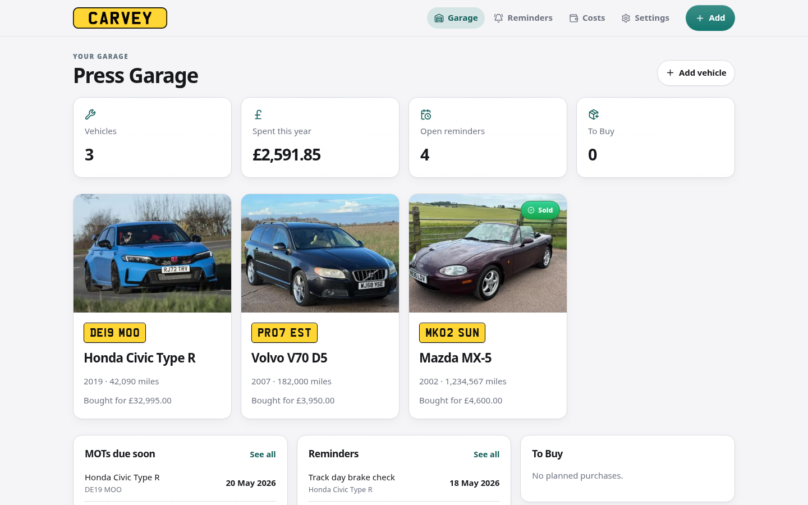
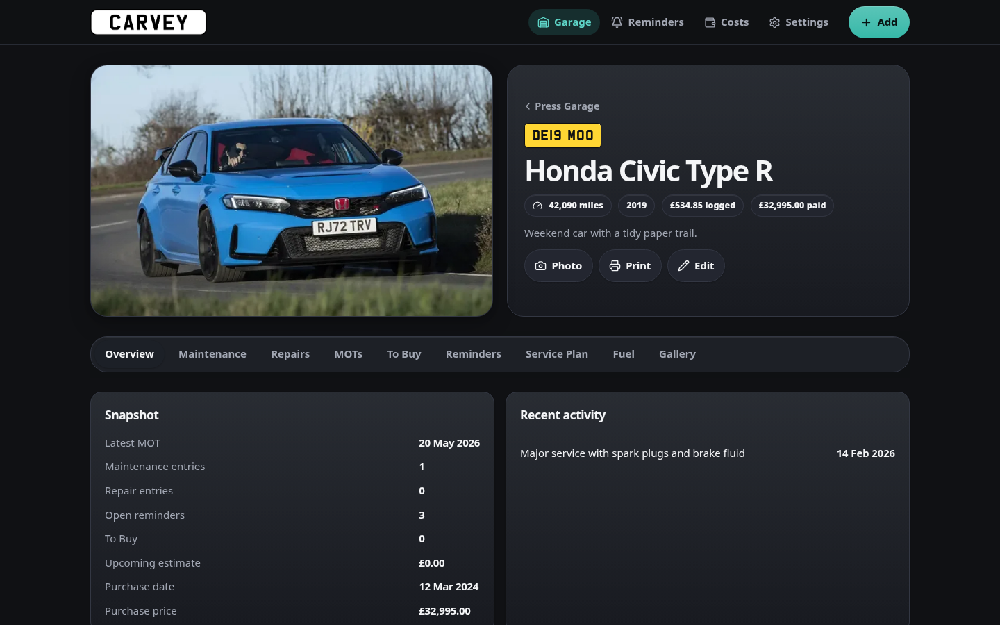
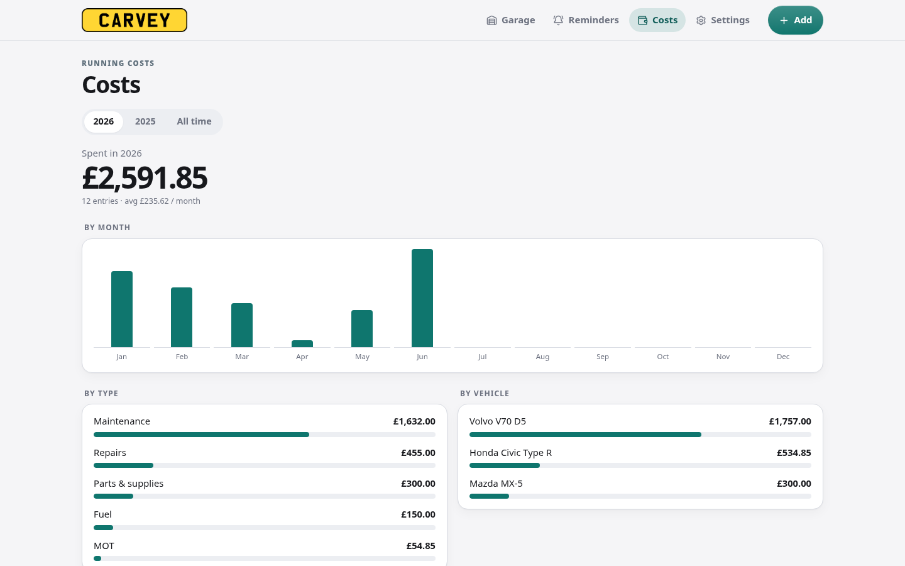
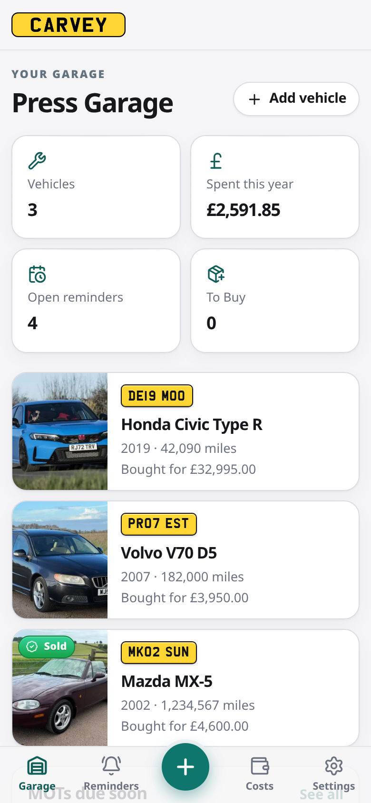
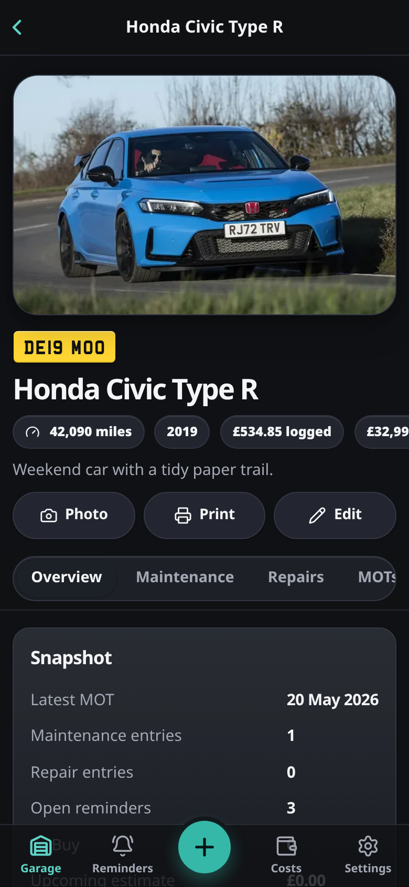
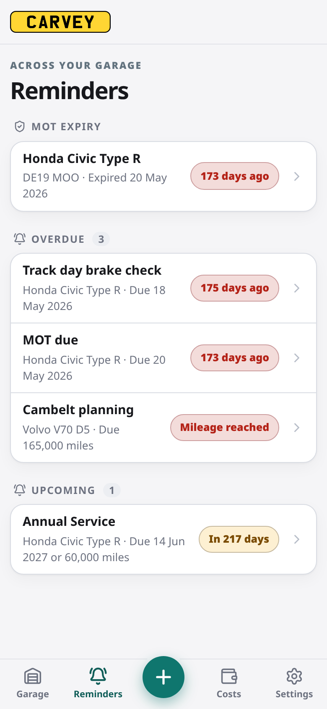

<p align="center">
  <picture>
    <source media="(prefers-color-scheme: dark)" srcset="public/icons/Carvey-plate-front.png">
    
  </picture>
</p>

Carvey is a self-hosted car maintenance tracker. It keeps the service history, MOTs, reminders, receipts and running costs for every car you own in one place. No accounts, no cloud: one SQLite database and an uploads folder.

## Screenshots

<details>
<summary><b>Desktop</b></summary>
<br>
<p align="center">
  
  
</p>
<p align="center">
  
</p>
</details>

<details>
<summary><b>Mobile</b></summary>
<br>
<p align="center">
  
  
  
</p>
</details>

## Features

**Garage**
- Any number of vehicles, each with a photo, plate, mileage, purchase details and notes
- Garage overview: spend this year, open reminders, MOTs due soon and items to buy
- Mark vehicles as sold

**Per vehicle**
- **Maintenance** and **Repairs**: date, mileage, cost, category, garage/workshop and notes
- **MOTs**: result, expiry and cost. Logging an MOT resets the MOT reminder
- **Renewals**: insurance, road tax, warranty and breakdown cover, with provider, policy number, dates, cost and documents. Each type keeps a reminder on its renewal date
- **Fuel**: fill-ups with volume, cost and odometer
- **Reminders**: by date, mileage or both, with optional repeats. Mileage-only reminders get an estimated due date from how far the car is driven
- **Service Plan**: reusable intervals (e.g. oil every 12 months / 6,000 miles) linked to reminders
- **To Buy**: planned parts, which convert into a maintenance or repair entry when bought
- **Gallery** and **attachments**: receipts, invoices and photos (PDF or image) on any record
- Printable full service history

**Across the garage**
- **Reminders** page: MOT expiry, renewals and every open reminder, grouped by overdue and upcoming
- **Notifications**: a daily summary of what's coming up or due, sent to ntfy, Gotify, Apprise (email, Telegram, Slack and more), Discord or any webhook
- **Calendar feed**: subscribe from Google, Apple or Outlook calendars to see reminders as all-day events
- **Costs** page: spend by month, type and vehicle, per year or all time
- **Quick add**: log anything for any vehicle from the bottom bar (mobile) or **Add** button (desktop)

**App**
- Installable as a PWA, with mobile tab navigation and bottom-sheet forms
- Light and dark mode, ten colour palettes, rounded or boxy shapes
- One-click backup and restore (database and uploads in one zip, with a preview before restore)
- CSV export (per record type or everything as a zip) and CSV import with column matching, duplicate detection and a preview before saving
- Sign-in with optional two-factor authentication (authenticator app + recovery codes), a signed-in devices list, and a reverse-proxy mode for Authelia, Authentik and similar

## Regional settings

**Settings → Regional**. Defaults are UK.

| Setting | Options |
|---|---|
| Currency | Any ISO 4217 currency |
| Distance | Miles · Kilometres |
| Fuel volume | Litres · Gallons |
| Date format | DD Mon YYYY · ISO 8601 |
| Plate colour | Yellow (rear) · White (front) |
| Annual test | MOT · Inspection · Custom name · Disabled |

## Quick start

**Docker Compose**

```bash
docker compose up -d
```

Open `http://localhost:3000` and create your admin account. Data is stored in `./data`.

**Local development** (Node 24+)

```bash
npm install
CARVEY_DATA_DIR=./data npm run dev
```

## Environment variables

| Variable | Purpose |
|---|---|
| `CARVEY_DATA_DIR` | Where the database and uploads are stored (`/app/data` in Docker) |
| `TZ` | Time zone, e.g. `Europe/London` |
| `CARVEY_RESET_PASSWORD` | Resets the admin password on startup (see below) |
| `CARVEY_AUTH_MODE` | `password` (default), `proxy` or `none`. Overrides the sign-in toggle in Settings (see [Sign-in and reverse proxies](#sign-in-and-reverse-proxies)) |
| `CARVEY_PROXY_SECRET` | Shared secret your proxy sends in proxy mode (16+ characters) |
| `CARVEY_PROXY_SECRET_HEADER` | Header carrying the secret. Default `X-Carvey-Proxy-Secret` |
| `CARVEY_PROXY_USER_HEADER` | Optional. Header with the signed-in user from your proxy, e.g. `Remote-User`. When set, requests without it are refused |
| `CARVEY_ALLOWED_ORIGINS` | Extra origins allowed to post to Carvey, comma-separated. Only needed if your proxy rewrites the `Host` header without setting `X-Forwarded-Host` |
| `CARVEY_SECURE_COOKIES` | `true` or `false` to force the session cookie's Secure flag. Default: on when the request arrived over HTTPS |
| `CARVEY_RESET_2FA` | Set to `true` to turn off two-factor on startup (see below) |
| `CARVEY_DISABLE_SCHEDULER` | Set to `true` to stop the built-in daily notification check (for example, when running several replicas) |

## Notifications and calendar

**Settings → Notifications.** Pick a service, paste its URL, then press **Send test**. Once a day, after the hour you choose (in the container's `TZ`), Carvey sends one summary of reminders that are due or coming up within your warning window. Each reminder is announced once when it's coming up and once when it falls due.

| Service | URL to enter |
|---|---|
| ntfy | The full topic URL, e.g. `https://ntfy.sh/my-private-topic`. Add a token for protected topics |
| Gotify | The server URL. Put the application token in **Token** |
| Apprise API | The notify endpoint, e.g. `http://apprise:8000/notify/carvey`. Covers email, Telegram, Slack, Pushover and more |
| Discord | The channel webhook URL |
| Webhook | Any URL. Carvey POSTs JSON with `title`, `body` and an `items` array |

**Calendar feed:** select **Create calendar link** and subscribe to it from your calendar app. The link works without a login, so treat it like a password; **Reset link** invalidates the old one.

## Importing from CSV

**Settings → Import & Export.** Choose what the file contains (maintenance, repairs, MOTs, fuel or renewals) and which vehicle it's for, or match rows by a registration column. Headers are matched by name, and common alternatives such as `mileage`, `price` or `litres` work. Dates can be ISO, day-first or month-first. A preview shows the columns used, the rows that will be skipped and why, and any rows already in Carvey, before anything is saved. Files exported from Carvey import back unchanged.

## Sign-in and reverse proxies

**Password (default).** Sign in with your username and password. Turn on two-factor in **Settings → Admin**: scan the QR code with any authenticator app, then save the 10 recovery codes it gives you. Each recovery code works once.

Failed sign-ins are rate limited (5 per 15 minutes from one client, 25 per 15 minutes for the account). Sessions last 30 days. **Settings → Admin** lists signed-in devices and can sign them out. Changing your password, or turning two-factor on or off, signs out every other device.

**Behind a reverse proxy that handles sign-in** (Authelia, Authentik, Cloudflare Access, oauth2-proxy, ...). Set:

```yaml
environment:
  CARVEY_AUTH_MODE: proxy
  CARVEY_PROXY_SECRET: "<long random string, e.g. from: openssl rand -hex 32>"
  CARVEY_PROXY_USER_HEADER: Remote-User   # optional: require the user header your auth provider sets
```

Then have the proxy add the secret to every request it forwards to Carvey:

| Proxy | Config |
|---|---|
| Traefik | `headers` middleware: `customRequestHeaders: { X-Carvey-Proxy-Secret: "<secret>" }` |
| Caddy | `reverse_proxy carvey:3000 { header_up X-Carvey-Proxy-Secret "<secret>" }` |
| nginx | `proxy_set_header X-Carvey-Proxy-Secret "<secret>";` |
| Others | Add a custom request header with the same name and value, if your proxy supports it |

Requests through the proxy are trusted. Requests without the secret, such as someone reaching the container port directly, still get the normal password and two-factor sign-in, so a published port is no longer an open door. Keep the secret out of anything the browser can see. If you set `CARVEY_PROXY_USER_HEADER`, make sure your proxy overwrites that header rather than passing a client's own value through.

**No sign-in** (`CARVEY_AUTH_MODE=none`, or the old **Turn sign-in off** option in Settings). Anyone who can reach Carvey has full access. Existing installs that used the toggle keep working, but turning it on now needs your password (and two-factor code), and restoring a backup never changes it. Prefer proxy mode.

## Password and two-factor reset

From inside the container, with no restart:

```bash
docker exec -it <container-name> node scripts/reset-password.mjs                # new password
docker exec -it <container-name> node scripts/reset-password.mjs --disable-2fa  # turn off two-factor
```

Or set `CARVEY_RESET_PASSWORD=newpassword` and/or `CARVEY_RESET_2FA=true`, restart, log in, then remove the variables and restart again. Every reset signs out all existing sessions.

## Tech stack

Next.js · React · TypeScript · SQLite (`better-sqlite3`) · Sharp · Vitest

## Issues and feedback

Report bugs and feature requests in [Issues](https://github.com/Revise0592/Carvey/issues).
