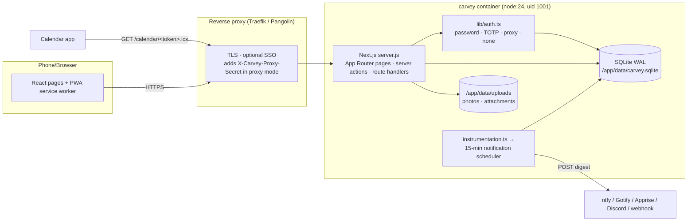

# Audit report

Scope: every file in the repository at `94b8875` (≈14,000 lines of TypeScript/TSX, plus Docker, CI and Unraid files). Line numbers refer to that commit unless a finding says otherwise.

**Severity scale.** *Critical*: exploitable now by someone without access, or certain data loss. *High*: a realistic path to account takeover, broken security control or lost/unusable data. *Medium*: a real defect or risk that needs an unusual situation or limited access. *Low*: hygiene, polish or defence in depth.

**Status.** ✅ fixed on this branch (see [CHANGES.md](CHANGES.md)) · 📋 proposed in [IMPROVEMENTS.md](IMPROVEMENTS.md) · 🛠 live change in [RUNBOOK.md](RUNBOOK.md)

---

## 1. Architecture overview

Carvey is one Next.js process with an embedded SQLite database. There is no separate API server, queue or cache.

**Request paths**

| Kind | Where | Auth check | Notes |
|---|---|---|---|
| Pages | `app/**/page.tsx` | `requireUser()` at the top of each page | Server-rendered from SQLite on every request (`force-dynamic`) |
| Mutations | `app/actions/*.ts` (server actions) | `requireUser()` first line; Next's built-in Origin check | Form posts; redirect back with a status in the query string |
| Uploads / restore / import | `app/api/*`, `app/settings/*/route.ts`, `app/vehicles/[id]/photo` | `rejectCrossOrigin()` then `requireUser()` | Multipart POST, read fully into memory |
| Downloads | `app/uploads/[...path]`, `settings/backup`, `settings/export` | `currentUser()` / `requireUser()` | Uploads served with `sandbox` CSP and `nosniff` |
| Public | `/api/health`, `/calendar/<token>.ics`, `/login`, `/setup` | none / token | Setup only works while no admin exists |

**Data.** One file, `carvey.sqlite` (WAL, foreign keys on). The schema is created and migrated on first open by `lib/db/schema.ts` (idempotent `CREATE TABLE IF NOT EXISTS` + `ensureColumn`). Data-access functions live in `lib/db/*` and are plain synchronous `better-sqlite3` calls with bound parameters. Uploaded files sit under `uploads/vehicles` (resized WebP photos) and `uploads/attachments/<vehicleId>/` (receipts, documents, gallery).

**Auth.** One admin account. Sessions are 48-hex random tokens in an `HttpOnly; SameSite=Lax` cookie, stored as SHA-256 digests, 30-day fixed expiry. Optional TOTP with 10 single-use recovery codes. Failed sign-ins are throttled per client and per account in SQLite. Proxy mode trusts requests carrying a shared secret header; `none` mode turns auth off.

**Background work.** `instrumentation.ts` starts a 15-minute `setInterval` that sends one daily digest after the configured hour.

**Backups.** A zip of a `VACUUM`ed copy of the DB (sign-in tables stripped) plus every upload, built in memory and downloaded by the user. Restore stages the zip, previews counts, snapshots the current data to `restore-rollback/`, then replaces every table inside one transaction.

**Overall:** a tidy, well-commented codebase. The recent security rework (hashed session tokens, TOTP, throttling, cross-origin checks on route handlers, scrubbed backups, sandboxed uploads) was done carefully, and the test suite exercises the risky parts. Most findings below are edge cases in that work rather than missing fundamentals.

---

## 2. Findings summary

| ID | Severity | Area | Finding | Status |
|---|---|---|---|---|
| H1 | High | Security | Login rate limit bypassed by parallel requests | ✅ |
| H2 | High | Security / data | Restoring a backup with no admin deletes the account and reopens `/setup` | ✅ |
| H3 | High | Reliability / data | No server-side date/number validation; one bad date permanently crashes a vehicle page | ✅ |
| M1 | Medium | Reliability | "Today" computed in UTC; daily digest on the wrong day, overdue flips at the wrong midnight | ✅ |
| M2 | Medium | Data integrity | Double-submitting a CSV import imports every row twice | ✅ |
| M3 | Medium | Privacy / disk | Deleting a vehicle leaves its documents on disk and in every later backup | ✅ |
| M4 | Medium | Security | Upload extension and type taken from the client; uploads accepted for missing records | ✅ |
| M5 | Medium | Dependencies | `zod` < 4.6.6 memory-exhaustion advisory (npm: High) | ✅ |
| M6 | Medium | Reliability | Documented `reset-password.mjs` recovery cannot run in the published image | ✅ |
| M7 | Medium | Security | Anyone can keep the owner locked out (25 wrong guesses per 15 min) | 📋 |
| M8 | Medium | Reliability | Backup and restore hold everything in memory; no limit on uncompressed size | 📋 |
| M9 | Medium | Deployment | Container published on all interfaces, no capability drop, floating tags | 🛠 📋 |
| M10 | Medium | Performance | Record tabs are not paginated (1.3 MB of HTML for 500 services) | 📋 |
| M11 | Medium | Security | CSP has no `script-src`, so it does nothing against XSS | 📋 |
| M12 | Medium | Reliability | Backups are manual only; nothing leaves the box automatically | 🛠 📋 |
| L1 | Low | Bug | Downloaded attachments get percent-encoded names | ✅ |
| L2 | Low | Bug | "No mots logged yet": acronym lower-cased mid-sentence | ✅ |
| L3 | Low | Bug | Re-zipped backups (with folder entries) refused as "unsafe" | ✅ |
| L4 | Low | Bug | Setup with a short password returns a 500 instead of a message | ✅ |
| L5 | Low | Bug | Service worker's offline fallback never has anything cached | 📋 |
| L6 | Low | Security | To Buy product URL accepts any scheme | 📋 |
| L7 | Low | Security | Re-authentication (password, 2FA, username changes) is not throttled | 📋 |
| L8 | Low | Security | Client key for throttling trusts `X-Forwarded-For` | 📋 🛠 |
| L9 | Low | Reliability | "Check now" and the scheduler can race and send the digest twice | 📋 |
| L10 | Low | Disk | Restore rollbacks, staging dirs and import previews are never pruned | 📋 |
| L11 | Low | Reliability | `/api/health` does not check the database or disk | 📋 |
| L12 | Low | Ops | No request or audit logging; errors only on stdout | 📋 |
| L13 | Low | UX | Server-side validation errors show a generic error page, not a field message | 📋 |
| L14 | Low | Code quality | Hard-coded dev origin IP, stale backup `appVersion`, Vite config warning | 📋 |
| L15 | Low | Dependencies | Dev-only advisories and minor version drift | 📋 |

Totals: **0 Critical · 3 High · 12 Medium · 15 Low.** Fixed here: 3 High, 6 Medium, 4 Low.

---

## 3. Security

### H1 — Login rate limit bypassed by parallel requests · High · ✅
**Where:** `lib/auth.ts:204-215` (`login`).
**What:** `throttleRetryAfter()` checked the failure counters, then `await bcrypt.compare(...)` yielded, and only afterwards was the failure recorded. Any number of requests sent at once all passed the check before the first failure was written. Reproduced in a test: 20 parallel wrong passwords → 20 checked, 0 throttled.
**Why it matters:** the throttle is the only brute-force protection for an internet-facing password login (Pangolin/Traefik do not rate-limit by default). With parallelism the "5 per 15 minutes" limit becomes unlimited, bounded only by bcrypt CPU time.
**Fix:** charge the attempt in the same synchronous step as the check, before the `await`, and refund it when the password turns out to be right. Now 5 checked, 15 throttled.

### H2 — Restoring a backup with no admin deletes the account and reopens `/setup` · High · ✅
**Where:** `lib/backup.ts:260-280` (`restoreDatabaseContents`).
**What:** restore empties every table and refills it from the backup. A backup with no rows in `admin_users` therefore leaves the server with no admin. `requireUser()` then redirects everyone to `/setup`, and the first person to load it creates the admin and owns all data. The packaged `data/demo/showcase-backup.zip` is exactly such a file (it is published without the account), as is any backup taken before setup.
**Why it matters:** one plausible click ("let me try the demo backup") silently converts an internet-reachable instance into an unclaimed one. In proxy mode the window is narrower but real for anyone hitting the container port.
**Fix:** when the backup has no admin, keep the live `admin_users` table.

### M4 — Upload type and extension come from the client · Medium · ✅
**Where:** `app/api/attachments/route.ts:47-60`, `app/api/gallery-photos/route.ts:44-56`.
**What:** the allow-list checked `file.type`, which the browser (or a script) sets freely, and the stored file kept the client's extension (`path.extname(file.name)`). An `.html` or `.svg` file labelled `text/plain` was stored as `.html`. The vehicle and record IDs were not checked: a bad ID wrote the file, then failed the foreign key with a 500 and left the file orphaned.
**Why it matters:** today the download route's `sandbox` CSP and `nosniff` stop stored files from running as pages, so this was defence-in-depth rather than an XSS. But the files sit in the data volume with misleading extensions, and any future change (static serving, a mobile client opening them) would expose it.
**Fix:** a shared `lib/uploads.ts` picks the extension from the MIME type, checks magic bytes, writes the file only after the record is confirmed to belong to the vehicle, and removes the file if the DB insert fails.

### M5 — `zod` memory-exhaustion advisory · Medium · ✅
**Where:** `package.json` (`zod ^4.1.13`, resolved 4.4.1). GHSA-mrhx-c7xc-m3w5, npm severity High.
**Why Medium here:** Carvey only validates scalar strings with zod, never user-sized arrays, so the vulnerable path is not reached. Upgrading is still free. **Fix:** `zod ^4.6.7`; `npm audit --omit=dev` is now clean.

### M7 — Anyone can keep the owner locked out · Medium · 📋
**Where:** `lib/auth.ts:153-167`.
**What:** the per-account limit (25 failures / 15 min) applies to every client. Anyone who knows or guesses the username (the default suggestion is `admin`) can send 25 wrong passwords every 15 minutes and the owner cannot sign in at all.
**Proposed fix:** exempt a client that recently signed in successfully (a long-lived, signed "known device" cookie), and/or make the per-account lock a slowdown (progressive delay) rather than a hard block. Proxy mode with SSO avoids the issue entirely.

### M11 — CSP does nothing against XSS · Medium · 📋
**Where:** `next.config.ts:5-11`.
**What:** the policy is `frame-ancestors 'none'; base-uri 'self'; object-src 'none'; form-action 'self'`. There is no `script-src`, so an injected script would run. React's escaping makes injection unlikely (no unsafe `dangerouslySetInnerHTML` with user data was found; the two uses are a static theme script and a QR SVG from a library), but CSP is the backstop.
**Proposed fix:** Next 16 supports per-request nonces via `proxy.ts`. Add `script-src 'self' 'nonce-…' 'strict-dynamic'`, `style-src 'self' 'unsafe-inline'`, `img-src 'self' data: blob:`, `connect-src 'self'`. Ship it as `Content-Security-Policy-Report-Only` first. Also add `Strict-Transport-Security` at the proxy.

### L6 — To Buy product URL accepts any scheme · Low · 📋
**Where:** `app/actions/purchases.ts:17,34`; rendered at `app/vehicles/[id]/_sections/planning.tsx:161`.
**What:** `javascript:` URLs are stored. React 19 refuses to render them as `href`, so it's not exploitable today; validate `^https?://` anyway.

### L7 — Re-authentication is not throttled · Low · 📋
**Where:** `lib/two-factor.ts:48` (`verifyReauthentication`), `regenerateRecoveryCodes`, `confirmTotpSetup`.
**What:** someone holding a stolen session can guess the password (or TOTP) for "change password" and "turn off 2FA" without limits. Reuse the login throttle keys.

### L8 — Throttle client key trusts `X-Forwarded-For` · Low · 📋 🛠
**Where:** `lib/auth.ts:157-160`.
**What:** if the proxy appends rather than overwrites `X-Forwarded-For`, or the container port is reachable directly, a client picks its own key and dodges the per-client limit (the per-account limit still applies). Configure the proxy to overwrite it (runbook) and add a `CARVEY_TRUSTED_PROXY` option to only honour it from the proxy's address.

### Checked and fine
- **SQL injection:** every query binds parameters. The few interpolations (`ensureColumn`, `restoreDatabaseContents`, `countRows`) use table/column names from the schema or `sqlite_master`, never request input.
- **Path traversal:** `safeUploadPath` rejects `..`, separators and absolute segments and re-checks the resolved prefix; restore validates every zip entry and manifest path; staging tokens are UUID-checked.
- **CSRF:** server actions get Next's Origin check; every multipart route handler calls `rejectCrossOrigin()` (verified live: cross-site POST → 403).
- **Sessions:** 192-bit tokens, stored hashed, `HttpOnly`, `SameSite=Lax`, `Secure` over HTTPS, revocable, pruned. Forged/expired cookies redirect to `/login` (verified live).
- **TOTP:** RFC 6238 with ±1 step, replay protection via `totp_last_counter` with an atomic `UPDATE … WHERE`, recovery codes hashed and consumed in a transaction.
- **Secrets:** none in the repo. `.env*` ignored. The notification token is never echoed back to the page. The calendar token is 192-bit and compared in constant time.
- **Proxy mode:** secret compared in constant time; requests without it fall back to password sign-in.
- **CSV export:** formula injection guarded (`=`, `+`, `-`, `@` prefixed with `'`).
- **Unauthenticated surface (verified live):** `/uploads/*` → 404, `/settings/export` → login, unknown calendar token → 404.
- **Container:** non-root user (uid 1001), no privileged mode in the Unraid template.

---

## 4. Reliability

### H3 — No server-side validation; one bad date crashes a vehicle page permanently · High · ✅
**Where:** all of `app/actions/*.ts` (e.g. `vehicles.ts:24`, `records.ts:15`, `reminders.ts:14`, `purchases.ts:18`) and `lib/format.ts:21-31`.
**What:** dates were checked with `z.string().min(1)` (or not at all) and numbers with bare `parseInt`/`parseFloat`. The `type="date"` input is the only real check. Found in exploratory testing: submitting a vehicle with purchase date `next tuesday` succeeded, and `/vehicles/1` then failed on every load with `RangeError: Invalid time value` thrown from `formatDate`. Costs of `abc`, negative odometers and `2026-02-31` were also accepted.
**Why it matters:** the data is the product. Any client without a native date picker (old Safari, some Android WebViews, a future mobile app, a script, a CSV-shaped paste) can make a vehicle permanently unviewable through the UI. The same happens if a restored backup or hand-edited DB holds a bad value.
**Fix:** shared `isoDate`/`nullableIsoDate`/`nullableInt`/`money` helpers in `app/actions/shared.ts` reject non-dates, non-numbers and negative odometers, used by every action. `formatDate` now prints an unparseable stored value as-is instead of throwing, so pages already holding bad data load again (verified on the live test instance).

### M1 — "Today" computed in UTC · Medium · ✅
**Where:** `lib/dates.ts:3-5`, `lib/db/reminders.ts:88`, `app/vehicles/[id]/print/page.tsx:22`; consumed by `lib/notifications.ts:225-228`.
**What:** `todayIso()` returned the UTC date while the scheduler compares the *local* hour. In the UK during BST, between 00:00 and 01:00 "today" is still yesterday. Far from UTC (e.g. Australia) the 09:00 digest is recorded against yesterday's date and runs again an hour later. Reminders flip to overdue at UTC midnight, and forms pre-fill yesterday's date late at night. `addMonths` mixed local noon with UTC output and could shift a day in zones beyond ±12 h.
**Fix:** `todayIso()` uses the local calendar day; `addMonths` does its arithmetic in UTC.

### M2 — CSV import double-submit imports twice · Medium · ✅
**Where:** `lib/data-transfer.ts:197-252` (`commitCsvImport`).
**What:** two confirm requests (double-click, retry on a slow phone connection) both read the staged preview before either deleted it. Reproduced: one import of one row → two rows.
**Fix:** claim the preview with an atomic `rename()` first; the loser gets "expired or already imported".

### M6 — Recovery script can't run in the published image · Medium · ✅
**Where:** `Dockerfile:26-28`; README "Password and two-factor reset".
**What:** the runner stage copies only Next's traced standalone output. `scripts/reset-password.mjs` and `bcryptjs` aren't traced (they're used outside Next), so `docker exec carvey node scripts/reset-password.mjs` fails with "Cannot find module". Verified by reproducing the runner layout. The `CARVEY_RESET_PASSWORD` env var route still worked, which is why this is Medium.
**Fix:** copy the script and `bcryptjs` into the runner stage.

### M8 — Backup and restore are memory-bound · Medium · 📋
**Where:** `lib/backup.ts:79-86` (`zip.toBuffer()`), `:115` (`file.arrayBuffer()`), `:345` (`extractAllTo`); `app/settings/backup/route.ts:7-10`.
**What:** the whole backup zip (DB + every photo and PDF) is built in RAM, then copied again into the response. Restore reads up to 256 MB into memory and extracts without a limit on uncompressed size. With a few GB of receipts, or a container memory limit, the backup button can OOM-kill the process.
**Proposed fix:** stream the zip to the response (`archiver` or `yazl`) and write uploads straight to disk; check each entry's uncompressed size and the total before extracting.

### M12 — Backups are manual only · Medium · 🛠 📋
**What:** the only backup is the Settings → Backup download. Nothing runs on a schedule and nothing leaves the host.
**Fix now (runbook):** back up the data volume with your existing restic job, using `sqlite3 .backup` (or a short stop) for a consistent DB copy.
**Proposed:** a built-in nightly backup to `data/backups/` with retention, which restic then picks up.

### L9 — Digest can be sent twice · Low · 📋
**Where:** `lib/notifications.ts:221-251`. A scheduler tick and "Check now" running together both select the same entries before either marks them sent. Guard with an in-process lock or claim entries in the log table before sending.

### L10 — Data directory never pruned · Low · 📋
**Where:** `lib/backup.ts:379-386` (each restore keeps a full DB + uploads copy in `restore-rollback/`), `:117` (abandoned `restore-staging/<token>`), `lib/data-transfer.ts:32` (abandoned import previews). Keep the last 3 rollbacks; delete staging older than 24 h on startup.

### L11 — Shallow health check · Low · 📋
**Where:** `app/api/health/route.ts:3-8`. Always returns 200, even if the DB is unreadable or the disk is full. Add `SELECT 1` and a writable check on the data dir.

### L12 — No request or audit logging · Low · 📋
Errors go to stdout via Next's default handler. There's no record of sign-ins, failed sign-ins, restores or settings changes. A small audit table (time, event, client, user agent) shown in Settings → Admin would help with both security and debugging.

### Restart behaviour (fine)
`restart: unless-stopped` plus a working Docker `HEALTHCHECK`. The DB is opened lazily and migrations are idempotent. WAL is safe under crashes. The scheduler restarts with the process and catches up because it runs whenever the hour has passed and today hasn't run.

---

## 5. Performance

Measured on the local production build with 20 vehicles × 500 services + 500 fill-ups + 10 reminders each (10,000 + 10,000 + 200 rows):

| Page | Median | HTML size |
|---|---|---|
| `/garage` | 63 ms | 81 KB |
| `/reminders` | 76 ms | 292 KB |
| `/costs?period=all` | 39 ms | 22 KB |
| `/vehicles/:id` (overview) | 19 ms | 32 KB |
| `/vehicles/:id?tab=fuel` | 116 ms | 740 KB |
| `/vehicles/:id?tab=maintenance` | 140 ms | **1,321 KB** |
| `/vehicles/:id/print` | 65 ms | 218 KB |

Query time is not the problem: SQLite answers everything in milliseconds and the indexes on `vehicle_id` cover every per-vehicle lookup. There are no N+1 patterns (attachments are grouped in one query per tab; regional settings load in one query).

### M10 — Record tabs not paginated · Medium · 📋
**Where:** `app/vehicles/[id]/_sections/records.tsx:20` and the other list sections.
**What:** every record of the type is rendered on every visit. At 500 services the page is 1.3 MB of HTML before compression, slow to parse on a phone over mobile data.
**Proposed fix:** show the latest 50 with "Show more" (cursor on `date, id`), or group by year with collapsed older years.

### Other notes
- `/reminders` is 292 KB for 200 reminders (~1.5 KB each). Each row is sent twice, once as HTML and once in the React Server Components payload, which is normal for Next. It lists every open reminder at once; limiting the "upcoming" group to the next 90 days (with "show all") would keep it small.
- `` is used for gallery thumbnails (2 lint warnings). Photos are already resized to WebP on upload, so `next/image` would add little; generating a thumbnail for gallery photos (currently served full size) would help more.
- A composite index `(vehicle_id, odometer)` on the four record tables would make the correlated `MAX(odometer)` subquery in `lib/db/vehicles.ts:28-38` index-only. Not needed at current sizes.
- Client bundle: `lucide-react` icons are imported by name (tree-shaken). No heavy client libraries.

---

## 6. Code quality

- **Strengths:** strict TypeScript with no `any` casts of note; data access isolated in `lib/db/*`; server actions grouped by domain; comments explain *why*; tests cover auth, backup/restore, CSV, mileage maths and notifications.
- **Duplication:** the two upload routes were near-copies (now share `lib/uploads.ts`). The `date/odometer/cost/notes` parsing block is repeated across maintenance, repair and purchase-conversion actions; a `recordInput(formData)` helper would remove ~60 lines.
- **Large files:** `components/Forms.tsx` (688 lines, 20+ forms) and `app/settings/page.tsx` (399 lines). Splitting per domain would match the rest of the codebase.
- **Inconsistent patterns:** some actions `redirect()` with a status in the URL, others return silently; validation failures throw (generic error page) rather than returning field errors (L13). Moving forms to `useActionState` with returned errors would make both consistent.
- **Dead/stale code:** `appVersion = "0.1.0"` in `lib/backup.ts:11` never changes (read `package.json` instead); the `archived` column is queried but never set by any action; `allowedDevOrigins: ["192.168.86.39"]` in `next.config.ts:16` is a personal LAN address in shared config.
- **Types:** `@types/better-sqlite3` sits in `dependencies` rather than `devDependencies`.
- **Tooling:** `vitest.config.ts` triggers a Vite "ESM in CommonJS" warning (rename to `.mts`). `npm run lint` passes with 2 warnings.

### Dependencies (`npm outdated`, `npm audit`)
| Package | Current | Latest in range | Note |
|---|---|---|---|
| zod | 4.4.1 | 4.6.7 | ✅ upgraded (advisory) |
| next / eslint-config-next | 16.4.3 | 16.4.6 | Patch releases; upgrade with the next release |
| react / react-dom | 19.2.5 | 19.3.1 | Minor; upgrade alongside Next |
| better-sqlite3 | 12.9.0 | 12.11.1 | Bundles a newer SQLite |
| eslint-config-next chain | — | — | 8 moderate dev-only advisories (`minimatch` ReDoS); not in the image |

---

## 7. Deployment hygiene

### M9 — Container hardening · Medium · 🛠 📋
**Where:** `docker-compose.yml:3-7`, `Dockerfile:1,6,13`, `unraid/Carvey.xml:4`.

| Issue | Why it matters | Fix |
|---|---|---|
| `ports: "3000:3000"` binds every interface | Behind a proxy, the app is also reachable directly on the LAN (and on the internet if the host is exposed), bypassing proxy SSO | Bind `127.0.0.1:3000:3000`, or drop `ports` and join the proxy's Docker network |
| No `cap_drop`, `no-new-privileges`, `read_only` | Limits damage if the Node process is ever compromised | Add them (runbook step 4); the app writes only to `/app/data` |
| `image: …:latest` + `build: .` in the same service | `docker compose up` may build locally instead of pulling; `:latest` makes rollbacks guesswork | Pin `:1.1.0` (or the digest); remove `build:` from the deployment copy |
| Base `node:24-bookworm-slim` not pinned by digest | Reproducibility; silent base changes between builds | Pin `@sha256:…` and let Renovate/Dependabot bump it |
| No memory limit | A large backup (M8) can take the host's memory | `mem_limit: 768m` |
| Unraid template uses `:latest` | Same as above | Document pinning in the template's description |

**Image:** multi-stage, non-root, `HEALTHCHECK` present, telemetry off, `.dockerignore` excludes data/secrets. Good. Image size is dominated by `sharp`'s libvips and `@img/*`, which is unavoidable.

**Update path:** CI builds and pushes on GitHub release, with PR builds as a smoke test. CI does **not** run the tests, lint or typecheck before publishing (`.github/workflows/docker-publish.yml`). Add a `test` job that the build job `needs`.
